# Getting started with sealed_lab

A walk through the app for your first evening with it: get the data for a set, build the best deck from a Sealed pool, then learn
the set and look up a card. It takes about 15 minutes, plus the time the app needs to calculate the set.

Not installed yet? Follow **Install** in the [README](README.md) first. Every detail of every tab is in the [GUIDE](GUIDE.md).

> The screenshots use the app's built-in example: a made-up set called **TST** with invented cards, drawn as coloured placeholders.
> With a real set you see the real card names and images.

The app has four tabs:

| Tab | What it is for |
|---|---|
| **Sets** | Get 17Lands data for a set and let the app learn from it. Done once per set. |
| **Deck builder** | Paste your pool, get the best decks, fine-tune one. |
| **Report** | What wins in the set, in plain language, plus a table of every card. |
| **Deck search** | Real decks that played a given card. |

**Tip:** hover over any number in the app to see what it means and how sure the app is about it.

---

## 1. First time: get the data for a set (Sets tab)

The app learns from [17Lands](https://www.17lands.com/public_datasets)' public game data. You do this once per set, and again when
you want fresher data.

**1.1 Pick the set.** The list shows the sets 17Lands has. A greyed one, like *TST* here, has no data on your computer yet. Click it,
then click **Download…**.

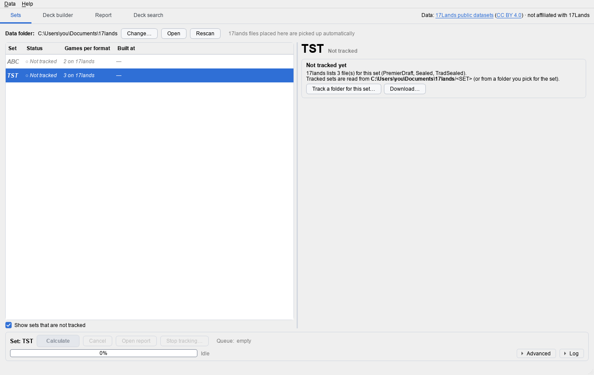

**1.2 Download.** A panel opens at the top of the window with the set's files. Keep them all ticked and click **Download selected**.
They are large (often a few hundred MB), so this can take a while. Leave the data folder as it is unless you have a reason to change
it.

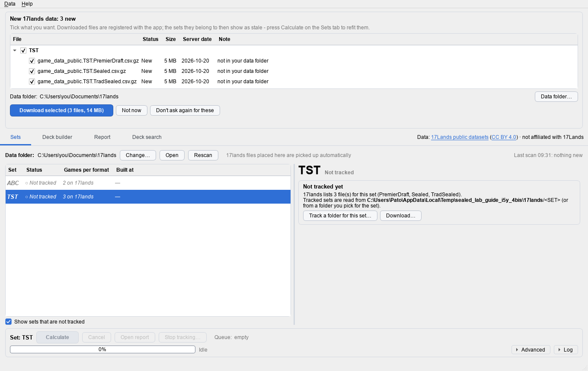

**1.3 Calculate.** The set now shows *Recalculation pending*. Click **Calculate**: the app studies the games and builds its model of
the set.

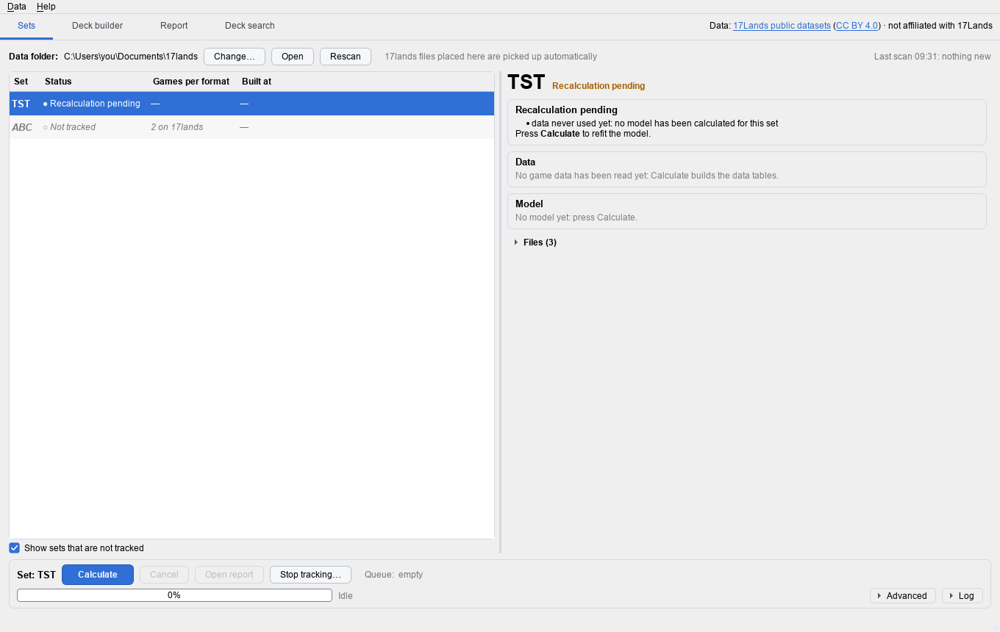

The bar at the bottom shows the progress. It takes several minutes, depending on the set and your computer. You can keep using the
other tabs for sets that are already calculated, and you can queue several sets.

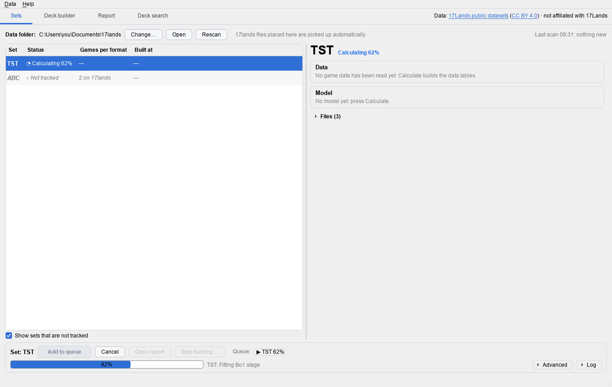

**1.4 Ready.** When the status turns green (*Ready*), the set can be used everywhere in the app. The panel on the right shows how
many games the model learned from and how well it predicts results it had not seen.

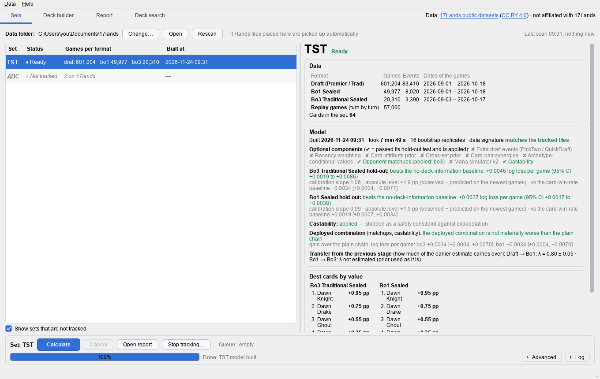

**Later:** when 17Lands publishes new data, the same download panel appears by itself when the app starts (or use **Data > Check for
new 17lands data**). Download, then press **Calculate** again.

---

## 2. Build a deck from a pool (Deck builder tab)

**2.1 Get your pool into the app.** Either way works:

- **Paste it.** In Arena, export your Sealed pool from the deck builder (it copies the card list), then paste it into the big box.
  To try the app without playing an event, paste any pool, for example a friend's or one from a past event.
- **Let the app pick it up.** With *Watch Arena for new sealed pools* on and **Detailed Logs** enabled in Arena's account options,
  a new Sealed pool appears in the app on its own (or click **Import from Arena log**).

The app finds the set from the card names (*Set: TST — detected (58/58 cards matched)*). If it misreads a name, it shows its guess
in a yellow box for you to confirm.

**2.2 Choose the format.** **Bo1** is Arena Sealed (one game per match, no sideboard). **Bo3** is Traditional Sealed (best of three,
sideboarding between games). Then click **Build best decks**.

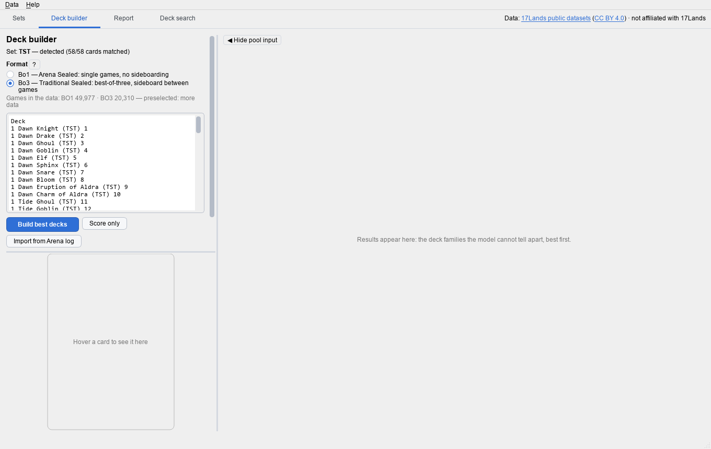

**2.3 Read the result.** You get one tab per deck the data can't tell apart, best first:
`#1 WU+r · 57.3% · P(best) 56%` means White-Blue splashing Red, an expected game win rate of 57.3% for an average player, and the
best deck in 56% of the app's re-checks. A pool with one clear best deck shows one tab.

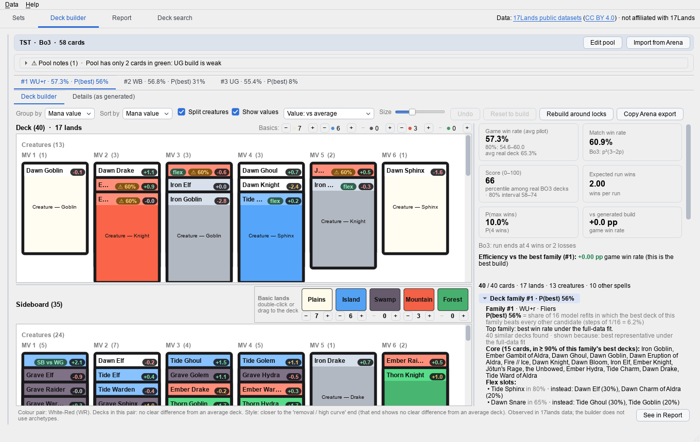

In each tab:

- The **deck** is on top and the rest of the pool is below. **Drag**, **double-click** or **right-click** a card to move it. Every
  number on the right updates at once, so you can try your own ideas and see whether they help.
- The badge on a card is its value: how many points of win rate it adds compared with an average card. Yellow means little data.
- **⚠ 60%** on a card means your mana casts it on time only 60% of the time. **flex** marks a slot where another card is about as good.
- Add or remove basic lands with the coloured strip beside *Sideboard* or the **Basics − +** buttons.
- **Undo** and **Reset to build** take you back. **Copy Arena export** copies the deck and sideboard so you can import them in Arena.

**2.4 Why this deck?** The **Details (as generated)** tab lists every card with its value and castability, the simulated mana
problems (screw, flood) and how much of the win rate comes from the cards, the curve and the mana.

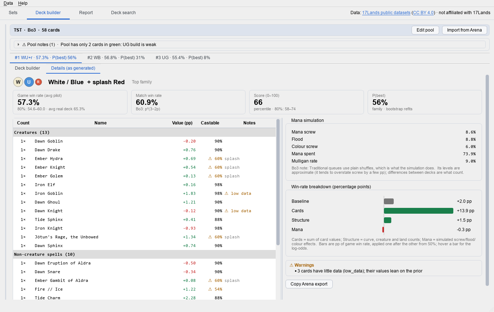

**Already built your own deck?** Paste Arena's export with both its *Deck* and *Sideboard* sections. Your deck then gets its own
first tab, compared with the app's best build. **Score only** rates it without searching.

---

## 3. Learn the set (Report tab)

The Report tab is the set in plain language. The **Summary** comes first, with the headlines, the cards players misjudge and how
winning decks are built. Below it you find the colour pairs, the cards, the archetypes, the winning deck shape and how the format
changed. The list on the left jumps to a section.

- Switch between **Best of 1** and **Best of 3** at the top.
- Hover a sentence of the summary to see the figures behind it, or click it to jump to them.
- When you have a pool in the Deck builder, a **For your pool** section shows which colour pairs your pool supports, and your cards
  carry a ★.
- **Cheat sheet…** prints the essentials on one page.

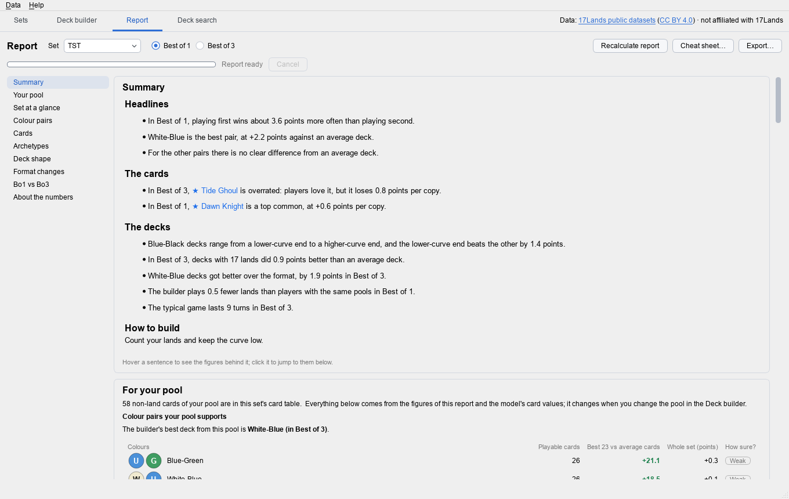

---

## 4. Look up a card

**In the Report:** open **More detail: all cards** (in the *Cards* section) and type the card's name in the search box. Its row shows
how often it is played, its value in each format and how sure the app is (*How sure?*). Hover or click the name to see the card.

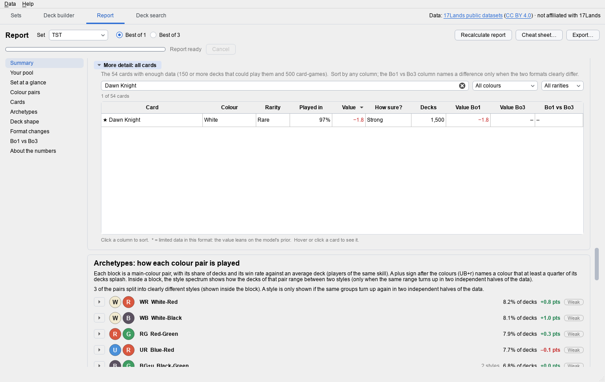

**In real decks (Deck search tab):** type a card name and press **Search** to list the 17Lands decks that played it, best results
first. Click one to see the whole deck, and **Copy deck** to take it to Arena. It is the quickest way to see how a strange card
is actually used.

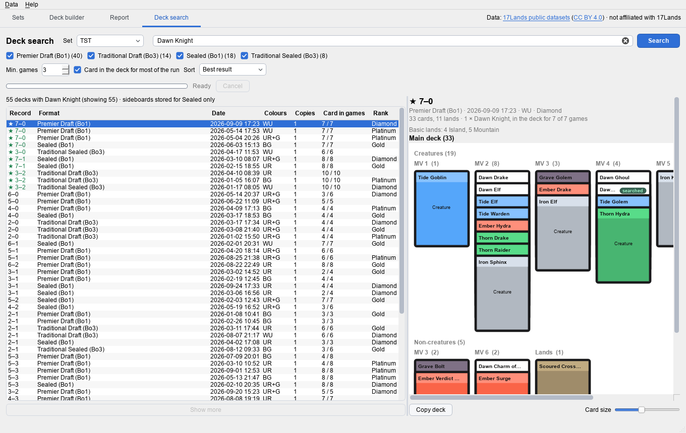

---

## Where to go next

- Hover anything: every number has an explanation.
- The [GUIDE](GUIDE.md) explains every tab, setting and number in detail.
- Something went wrong? See *Something went wrong?* in the [README](README.md).
- The app updates itself: see **Help > Check for updates…**.
