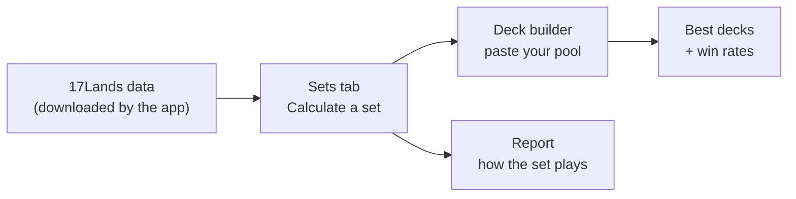
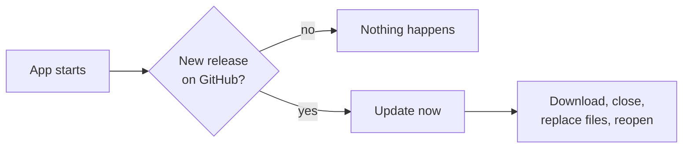

# sealed_lab

Paste your Sealed pool from MTG Arena and get the best deck to build, with its chance of winning. Built on
[17Lands](https://www.17lands.com) public data, for Windows.

## Install

1. Download `sealed_lab-X.Y.Z.zip` from the **[Releases](../../releases)** page and unzip it, e.g. to `C:\Tools\sealed_lab`.
2. Double-click **`run_windows.bat`**. The first run takes a few minutes: it installs Python and everything the app needs,
   then puts a **sealed_lab** shortcut on your Desktop. (If Windows warns you: *More info > Run anyway*.)
3. From now on, open the app from the shortcut.

## Use it

1. **Sets tab**: click a set (greyed out = no data yet), press **Download…**, then **Calculate**. The app builds its model
   for that set (a few minutes).
2. **Deck builder**: in Arena, export your Sealed pool and paste it here. The app finds the set by itself.
3. Press **Build best decks**. You get up to 5 tabs, one per deck the data can't separate, e.g. `#1 WU · 73.4%`.
   Drag cards in and out: every number updates as you edit.
4. **Report tab**: what wins in this set, in plain language. **Cheat sheet…** prints it on one page.

**Tip:** hover over any number in the app to see what it means.

## Updates

The app checks at most once a day; nothing to set up. Turn it off in **Help > Check for updates automatically**, or check by
hand with **Help > Check for updates…**.

Your data and models live in `%LOCALAPPDATA%\sealed_lab` and are never touched by an update.

## Something went wrong?

| Problem | Fix |
|---|---|
| The update check fails | Check your internet connection, then **Help > Check for updates…** |
| The app does not start | Run `run_windows.bat` again |
| An error message | Details are in `%LOCALAPPDATA%\sealed_lab\logs\` (`errors.log`, `update.log`) |

## More

- [GUIDE.md](GUIDE.md): every tab, setting and number explained in detail.
- [DEVELOPING.md](DEVELOPING.md): running from source, tests, releasing.

---

**Data:** [17Lands public datasets](https://www.17lands.com/public_datasets), licensed
[CC BY 4.0](https://creativecommons.org/licenses/by/4.0/). Win rates, scores and reports are this app's own model of that data;
sealed_lab is not affiliated with or endorsed by 17Lands. It only downloads the public dataset files and never calls the 17Lands
site API ([usage guidelines](https://www.17lands.com/usage_guidelines)). Card images and data come from
[Scryfall](https://scryfall.com) and are cached on your computer, never stored in this repository.

sealed_lab is unofficial Fan Content permitted under the [Fan Content Policy](https://company.wizards.com/en/legal/fancontentpolicy).
Not approved/endorsed by Wizards. Portions of the materials used are property of Wizards of the Coast. ©Wizards of the Coast LLC.

**License:** the code is [MIT](LICENSE). The 17Lands data, Scryfall data and card images keep their own terms.
