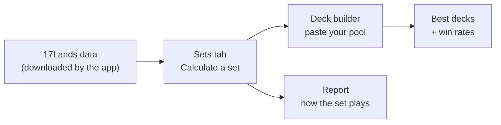
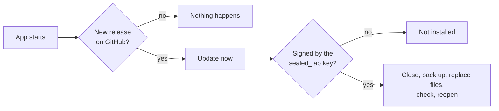

# sealed_lab

Paste your Sealed pool from MTG Arena and get the best deck to build, with its chance of winning. Built on
[17Lands](https://www.17lands.com) public data, for Windows and Ubuntu.

## Install

Download `sealed_lab-X.Y.Z.zip` from the **[Releases](../../releases)** page.

**Windows**

1. Unzip it, e.g. to `C:\Tools\sealed_lab`.
2. Double-click **`run_windows.bat`**. The first run takes a few minutes: it installs Python and everything the app needs,
   then puts a **sealed_lab** shortcut on your Desktop. (If Windows warns you: *More info > Run anyway*.)
3. From now on, open the app from the shortcut.

**Ubuntu**

1. Unzip it, e.g. to `~/sealed_lab`, open a terminal in that folder and run `bash run_linux.sh`. The first run takes a few
   minutes: it installs uv, Python and everything the app needs, then adds **sealed_lab** to your app menu.
2. From now on, open the app from the menu.
3. If Qt complains about a missing library: `sudo apt install libxcb-cursor0`.

## Use it

New here? [GETTING_STARTED.md](GETTING_STARTED.md) walks you through it with screenshots.

1. **Sets tab**: click a set (greyed out = no data yet), press **Download…**, then **Calculate**. The app builds its model
   for that set (a few minutes).
2. **Deck builder**: in Arena, export your Sealed pool and paste it here. The app finds the set by itself.
   (Arena on Linux through Steam/Proton, Lutris or Bottles is found automatically; otherwise just paste the pool.)
3. Press **Build best decks**. You get up to 5 tabs, one per deck the data can't separate, e.g. `#1 WU · 73.4%`.
   Drag cards in and out: every number updates as you edit.
4. **Report tab**: what wins in this set, in plain language. **Cheat sheet…** prints it on one page.

**Tip:** hover over any number in the app to see what it means.

## Updates

The app checks at most once a day, anonymously (no GitHub account or token involved); nothing to set up. It installs an update
only if the release is signed with the project's key and the download matches it byte for byte, and it keeps the previous version
until the new one has started correctly. Turn it off in **Help > Check for updates automatically**, or check by hand with
**Help > Check for updates…**. It works the same on Windows and Ubuntu. Details: [SECURITY.md](SECURITY.md).

Your data and models live in `%LOCALAPPDATA%\sealed_lab` (Windows) or `~/.sealed_lab` (Ubuntu) and are never touched by an update.

## Something went wrong?

| Problem | Fix |
|---|---|
| The update check fails | Check your internet connection, then **Help > Check for updates…** |
| The app does not start | Run `run_windows.bat` (Windows) or `bash run_linux.sh` (Ubuntu) again |
| An error message | Details are in `%LOCALAPPDATA%\sealed_lab\logs\` (Windows) or `~/.sealed_lab/logs/` (Ubuntu): `errors.log`, `update.log` |

## More

- [GETTING_STARTED.md](GETTING_STARTED.md): your first evening with the app, step by step with screenshots.
- [GUIDE.md](GUIDE.md): every tab, setting and number explained in detail.
- [DEVELOPING.md](DEVELOPING.md): running from source, tests, releasing.
- [CONTRIBUTING.md](CONTRIBUTING.md): how to suggest a change (pull requests are welcome).

---

**Data:** [17Lands public datasets](https://www.17lands.com/public_datasets), licensed
[CC BY 4.0](https://creativecommons.org/licenses/by/4.0/). Win rates, scores and reports are this app's own model of that data;
sealed_lab is not affiliated with or endorsed by 17Lands. It only downloads the public dataset files and never calls the 17Lands
site API ([usage guidelines](https://www.17lands.com/usage_guidelines)). Card images and data come from
[Scryfall](https://scryfall.com) and are cached on your computer, never stored in this repository.

sealed_lab is unofficial Fan Content permitted under the [Fan Content Policy](https://company.wizards.com/en/legal/fancontentpolicy).
Not approved/endorsed by Wizards. Portions of the materials used are property of Wizards of the Coast. ©Wizards of the Coast LLC.

**License:** the code is [MIT](LICENSE). The 17Lands data, Scryfall data and card images keep their own terms.
